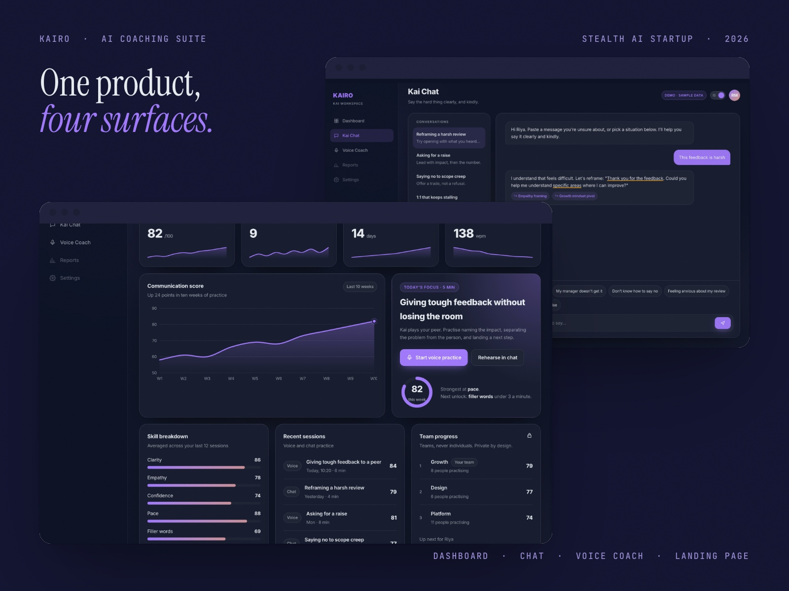
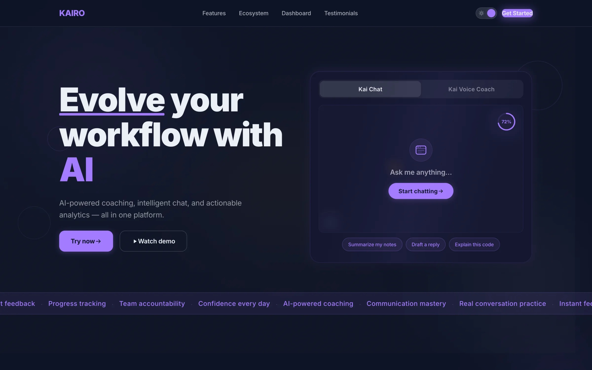
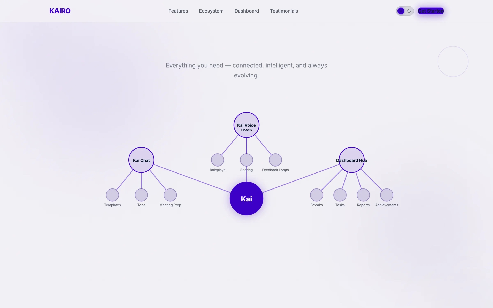
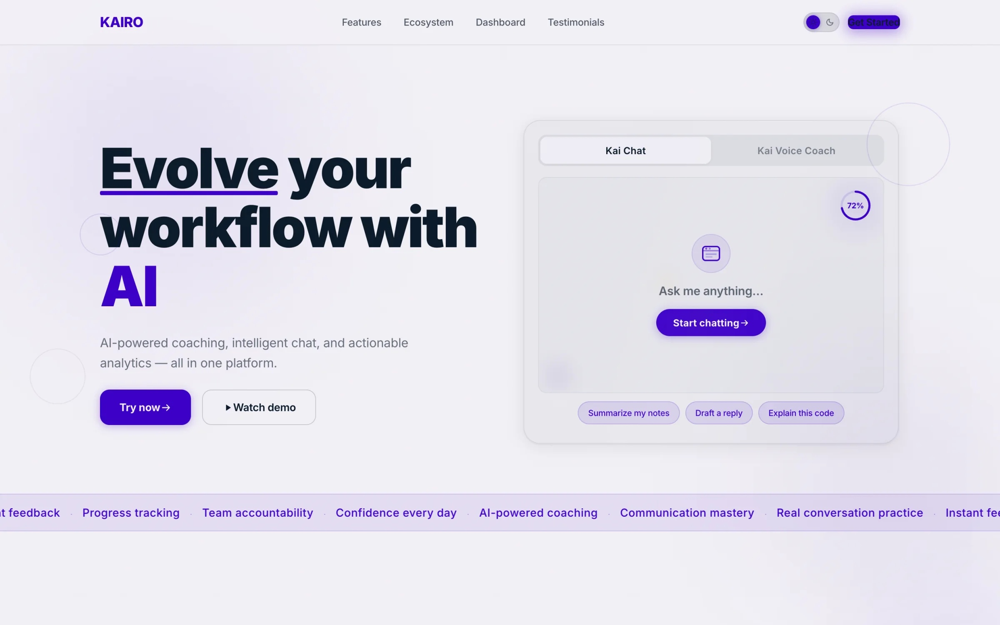
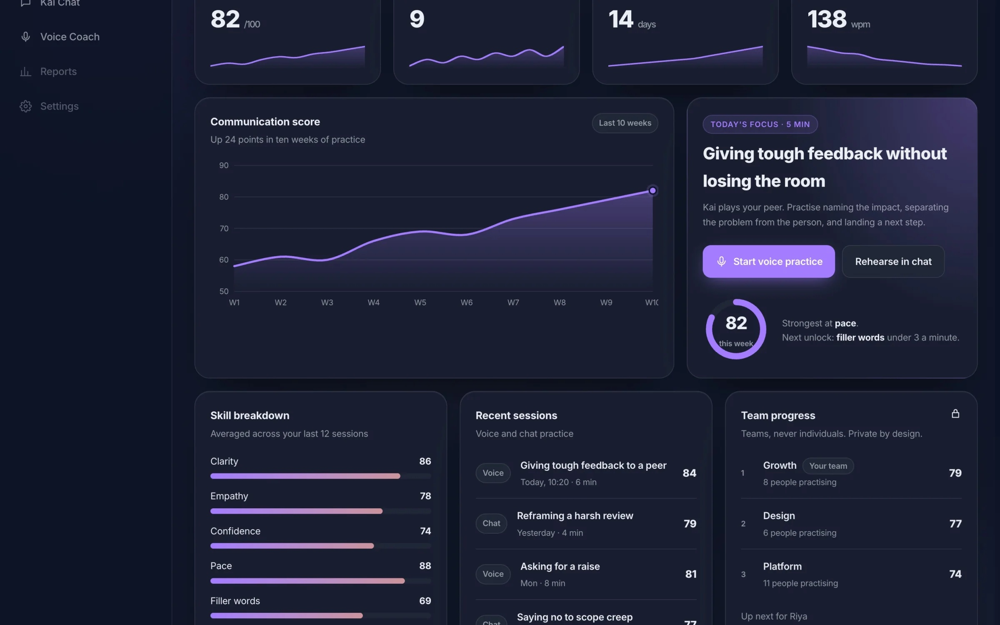
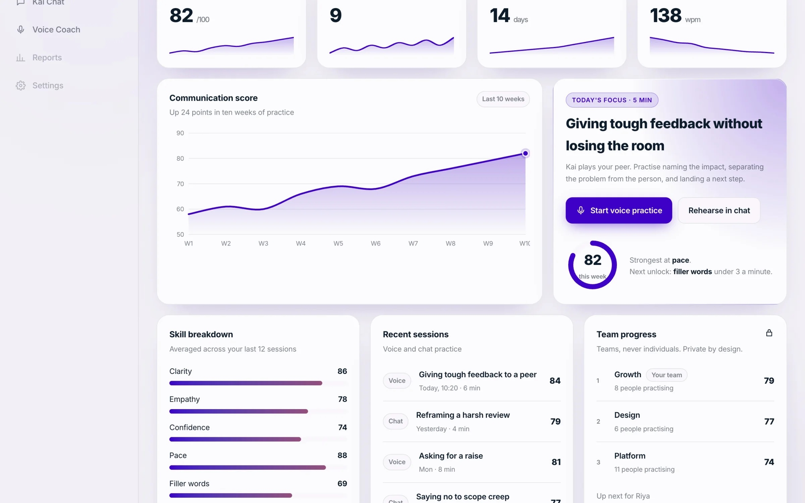
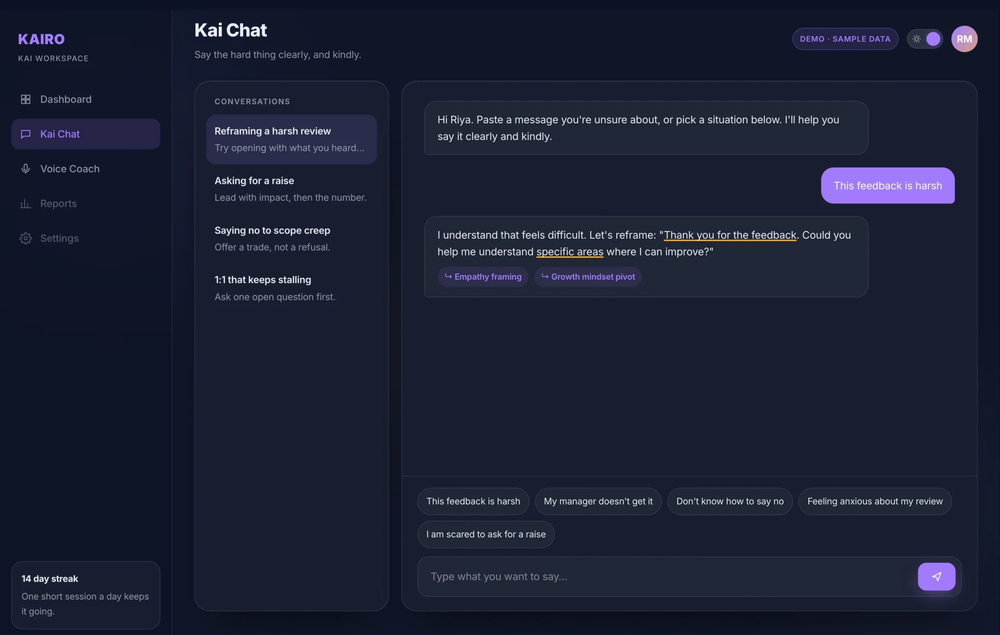
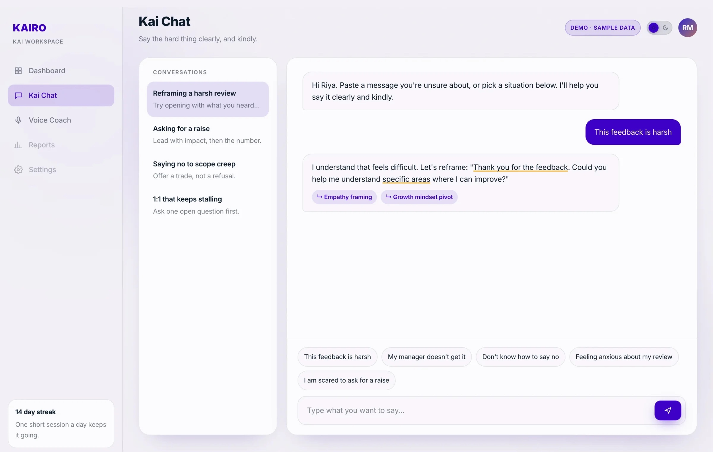
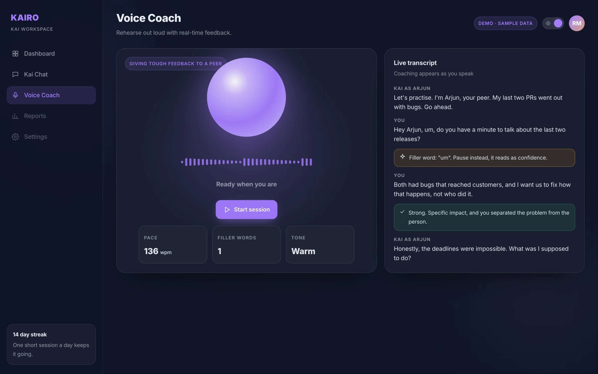
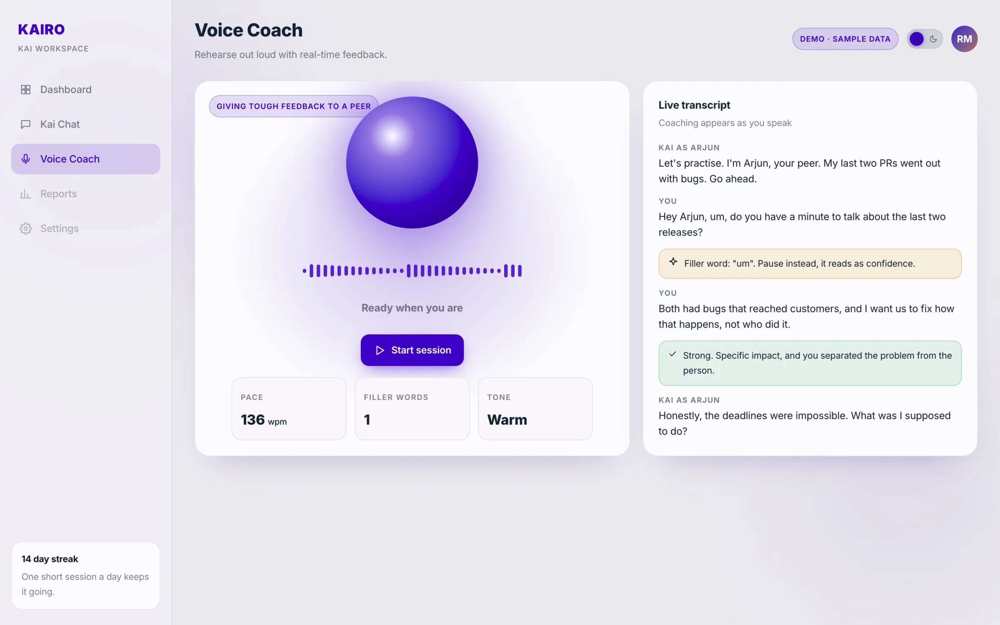

# Kairo: An AI Coaching Suite

**Product design for a B2B AI coaching startup in stealth: landing page, dashboard, chatbot and voice coach. Product Design Consultant, January to April 2026, rebuilt and redesigned as live demos in October 2026.**

A note on names: the AI startup I designed this for is still in stealth, so it appears here as Kairo, its products as Kai, and every screen is my own 2026 rebuild with sample data. The live version is one click away.

Live demos: [landing page](https://anurag.studio/work/kairo-landing-page/live) · [dashboard](https://anurag.studio/work/kai-dashboard/live) · [chatbot](https://anurag.studio/work/kai-chat/live) · [voice coach](https://anurag.studio/work/kai-voice-coach/live)

## Kairo: The Landing Page

Kairo sells AI coaching to companies. Not the kind that books a workshop and disappears, but a system employees actually talk to when a hard conversation is coming. My job was the page that has to explain all of that before anyone scrolls.

### Two Sceptics, One Page

A page like this is read by two people who distrust it for opposite reasons. The buyer has seen enough products with AI in the name to assume this one is a wrapper. The employee who will actually use it assumes it was bought to score them.

Ignoring either of them is how these pages fail. So the page takes a position in the headline instead of hedging. It is a claim about who is in charge, the person or the software, made before the product is even named.

The hero in dark theme. The product sits beside the headline from the first frame: Kai Chat on one tab, the voice coach on the other.

### Show the Product, Not an Orb

The panel beside the headline was the argument I cared most about winning. The default for a B2B AI site is a glowing orb, an unreadable dashboard, or a stock photo of people pointing at a laptop. None of them say what the thing does.

A working slice of the product does. The visitor sees the chat, the voice coach and the prompts people actually start with, and understands the product, the tone and the boundary in about three seconds.

Everything else on the page is sequenced behind that: what it does, who it is for, what it costs you to try, and the proof that makes those claims survivable.

The ecosystem map in light theme: chat, voice coaching and the dashboard hub, all branching from one assistant.

### The Small Things That Took Longest

The trust signals. The customer logos, the line about professionals already growing with Kai, the ticker of outcomes along the bottom edge. Each one is a few words and each one was argued over, because on a page whose job is a demo booking, those are the difference between a click and a closed tab.

The rule I held to: every number on the page has to be one the company can defend in a sales call. A landing page that overstates gets found out in the first meeting, and then the whole page is a liability.

Light theme. The same grid and type scale, so the page reads as one system in both.

### What I Did

- Designed the full page: hero, product sections, proof, and the path to a demo booking
- Contributed to the frontend build, so it shipped as designed rather than as interpreted
- Set the type scale, spacing and colour that the product suite then inherited, which is why the dashboard, chat and voice coach read as the same company
- Built the responsive behaviour properly, including the scrolled and signed-in states most marketing sites forget
- Rebuilt and renamed the page in 2026 as the live demo linked from this case study

### Where It Stands

The original page shipped as the startup's public front door. I worked on it as a design consultant with a frontend contribution, alongside their team, rather than as sole owner of the product. The version linked here is my own rebuild, renamed and recoloured while the company is in stealth.

## Kai Dashboard: The Room You Come Back To

A landing page has to win three seconds. A dashboard has to survive three months.

### The Room You Come Back To

This is the screen a Kai user opens on a Tuesday morning. Their company bought the product, somebody sent a link, and now there is a piece of software asking for a slice of a day that is already full.

The whole thing lives or dies on one question: does it give me something worth doing in the next five minutes, or is it another tab I close?

The 2026 redesign in dark theme. Four numbers that matter, the score trend, and Today's Focus beside it with one button to start.

### One Thing First

Most dashboards open with a wall of numbers and leave the user to work out what to do about them. I inverted that. The focus card names one skill, a time cost and one button: giving tough feedback, five minutes, start voice practice.

No interpretation required. You do not have to understand your own engagement metrics to know what that card is asking of you.

Chat and voice practice are one tap away from that card. Progress sits lower, because reviewing your own progress is not the behaviour the product needs from you on a Tuesday morning. It is the behaviour it needs on a Friday.

### Designing the Locked State

In the original free tier, company benchmarks and weekly activity were locked. The easy call was to hide them and show a clean screen.

I kept them on screen, dimmed, with the padlock and the real module name visible. Three reasons, in order of how much they mattered:

- Hiding a feature makes the product feel small. A visible ceiling makes it feel like there is somewhere to go
- It is honest about what the paid tier actually contains, which is a better upgrade prompt than a modal that appears when you click the wrong thing
- It stops a new account collapsing into empty space, and the empty account is the state most users see first and most teams design last

### Teams, Never Individuals

The original roadmap had a public leaderboard. I argued against it: a product that exists to take the social pressure out of hard conversations cannot rank colleagues against each other. The redesign keeps progress team based and private, and says so on the card.

Light theme, same grid. Skill breakdown, recent sessions and team progress, private by design.

### Two Themes, One Grid

Dark and light are not a taste toggle here. HR leads present this screen in meeting rooms with the lights up. Employees use it alone at a desk, often late. Both are real contexts and neither is the default.

So the grid holds still between them. Only the surface changes. Nobody should have to relearn where their own progress lives because the theme changed.

### What Changed in 2026

- A KPI row with sparklines, so the trend is visible before the detail
- One score trend chart in place of several small ones
- Today's Focus kept as the lead, now linking straight into chat or voice practice
- The same tokens and type as the landing page, so the suite finally reads as one product

### What I Owned

- Information hierarchy and the module grid, across both themes and every account state
- Empty, locked and first run states, which is where most dashboard designs quietly give up
- The component set that the chat and voice products reused, so the suite reads as one system rather than three

I worked on the original as a design consultant to the startup's team, and the engineering was theirs. The 2026 rebuild linked here is mine, with sample data.

## Kai Chat: An AI Coaching Chatbot

Kai Chat is where an employee brings the thing they cannot say out loud. A manager taking credit for their work. A review they are dreading. A resignation they have not decided on yet.

### Not a Chat Window With a Logo On It

That context changes the design problem completely. A general purpose chat interface is optimised for getting an answer quickly. This one has to be optimised for getting someone to start typing at all.

The person on the other side is about to describe a workplace problem, in writing, to software their employer paid for. Every ordinary chat convention has to be re-examined against that.

A reply in the 2026 rebuild. Kai rewrites the message, underlines the phrases doing the work, and names why each one helps.

### The Blank Page Problem

The hardest screen in the product is the one before the conversation starts. A cursor blinking in an empty box asks the user to summarise their own workplace problem in a sentence, cold. Most people close the tab.

So the empty state offers ways in instead, phrased the way a person would actually say them out loud: this feedback is harsh, my manager doesn't get it, I don't know how to say no.

Picking one is a much smaller act than composing an opening line. It also quietly teaches the user what the product is for, which a placeholder saying "Ask me anything" never does.

### Showing the Reasoning

A rewritten sentence on its own teaches nothing. So every reply underlines the phrases that carry it and labels them, empathy framing, growth mindset pivot, so the person learns the move and not just the line.

Light theme. Conversations on the left, the prompts people actually start with above the input.

### Consent Before Anything

The product works better if it remembers your history. That is also precisely the thing an employee should be nervous about.

So consent is a full screen, shown before the first message, written in sentences rather than policy language. It says what is stored, what it is used for, and how to clear it. The user can decline and still use the product.

In a tool where the employer is the customer and the employee is the user, being visibly straight about data is the entire basis on which anyone types anything honest into it.

### The Voice Sibling

Kai Voice Coach handles the same conversations out loud, for people rehearsing a real exchange rather than drafting one. Speaking a difficult sentence and typing it are different skills, and the second does not prepare you for the first.

Its microphone request follows the same rule as the chat consent screen. The compliance details, the deletion window and a genuine text only option are visible at the moment of the ask. A permission prompt with no context gets denied, and a denied microphone in a voice product is a dead end.

### What I Owned

- The conversational flow: entry states, suggestion design, and how a coaching exchange is structured differently on screen from ordinary chat
- The consent experience across both the chat and voice products
- Empty, loading and permission declined states, because those are the ones real users actually hit

Design consultancy work for the startup's team, built on the system established by the landing page and dashboard. The live demo is my 2026 rebuild with scripted sample replies.

## Kai Voice Coach: Rehearse Out Loud

### When Text Isn't Enough

AI voice roleplay for high-stakes workplace conversations. Think: preparing for a difficult performance review, practising a salary negotiation, or rehearsing feedback for a peer.

### Why Voice Matters

Written coaching has limits. When someone needs to practise a tough conversation, they need to actually speak. Kai Voice Coach puts people in realistic scenarios where the AI plays the other side and adapts to tone, confidence and content.

A session in progress. Kai plays your peer, the transcript runs on the right, and coaching appears the moment it is useful.

### My Design Approach

- Minimal, so nothing competes with the conversation
- Clinical warmth: the interface feels safe and professional at the same time
- System checks that build confidence before the roleplay starts
- Clear session states: preparation, live coaching, and reflection

### Coaching That Lands While You Speak

Feedback after a session is a report. Feedback during it is coaching. The redesign surfaces one note at a time beside the transcript, a filler word, a well placed moment of empathy, a pace reading, and colours each by kind so it can be read in a glance mid sentence.

Light theme. Pace, filler words and tone sit under the orb, so the numbers never cover the conversation.

### The Tension

Voice UX is unforgiving. There is no undo and no delete key. The visual layer has to be a calm anchor while the conversation is emotionally intense, so I stripped the interface down to essentials and let breathing room do the heavy lifting.

---

Designed by **Anurag Adhikari** · Anurag Studio · [anurag.studio](https://anurag.studio) · hello@anurag.studio
